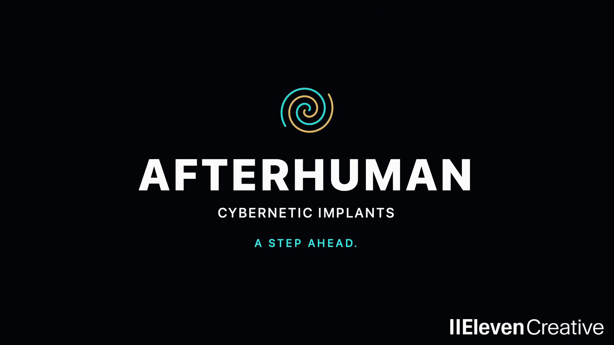

# AFTERHUMAN

**Cybernetic implants. A step ahead.**

A fictional implant company sells an extraordinary solution to an ordinary
problem: missing the train to work. Riley Brooks begins as a breathless commuter
in office clothes. One upgrade later, she can calculate her route, rescue a
falling coffee cup, force open heavy steel doors, and race the train through a
futuristic city. The punchline reverses the opening: the train is trying to catch
*her* now.

Created for ElevenCreative's [The Search for the World's Catchiest Ad](https://elevenlabs.io/creative/thesearch),
AFTERHUMAN combines playful corporate satire, a character-led action story,
original instrumental music, and a deliberately matter-of-fact sales pitch.
This repository contains the film's references, prompts, generated takes,
soundtrack, editing tools, review history, and delivery files.

[](assets/10-submission/afterhuman-watermarked-v01/afterhuman-submission-watermarked-v01.mp4)

## Watch and listen

| Deliverable | File or project |
| --- | --- |
| Official-watermarked export | [Watch/download the MP4](assets/10-submission/afterhuman-watermarked-v01/afterhuman-submission-watermarked-v01.mp4) · [Local review page](assets/10-submission/afterhuman-watermarked-v01/index.html) |
| Creator-selected edit, without contest watermark | [Arm-cleanup v07](assets/08-edit/continuous-ad-review-v07/afterhuman-arm-cleanup-v07.mp4) · [Review and before/after comparison](assets/08-edit/continuous-ad-review-v07/index.html) |
| Original selected music | [Chrome Swagger](assets/07-jingle/afterhuman-instrumental-chrome-swagger-v01.mp3) |
| Original selected narration | [David — The Movie Trailer](assets/09-voiceover/auditions/american-bass-v01/afterhuman-vo-david-full-v01.mp3) |
| ElevenCreative music workspace | [Chrome Swagger and retained auditions](https://elevenlabs.io/app/flows/1Wm2iEn6GL4TBWH62VVi); the selected node is labelled **Chrome Swagger — SELECTED AFTERHUMAN jingle** |

The delivered video is **44.875 seconds, 1,077 frames at 24 fps, 1920 × 1080,
16:9**, with stereo 48 kHz AAC audio. The canvas is 1080p; much of the generated
footage originated at 480p. The station sequence received a dedicated 2× upscale.

The creator selected v07 for publication on November 2, 2026. The watermarked
copy preserves its edit and compressed audio. The repository records export
preparation and a verified public music workspace; it does not establish that
social publication or competition submission was completed. See
[delivery status](#delivery-status-and-known-limits).

**Explore:** [Story and script](#the-story-from-first-step-to-last-frame) ·
[Creative direction](#creative-direction-and-the-details-that-matter) ·
[Asset bible](#characters-world-and-asset-bible) ·
[Making-of](#how-it-was-made) · [Repository guide](#repository-guide) ·
[Local workflow](#viewing-and-reproducing-the-local-work).

## The story, from first step to last frame

The central promise is easy to retell: **AFTERHUMAN gives a woman the abilities
to outrun the train she missed.** All four powers belong to the same commute.
The emotional progression is frustration, curiosity, transformation, discovery,
and confident exhilaration.

Times below describe the selected v07 edit, rounded to milliseconds. The
[frame-based timeline](assets/08-edit/continuous-ad-review-v07/timeline.json)
contains the exact ranges.

| Time | What happens | What it contributes |
| --- | --- | --- |
| 0.000–6.083 s | Three close views: running legs in heels; a bouncing KORVEX employee badge; Riley panting through a strong under-chin fisheye. | Establishes urgency, a working person, and physical effort before revealing her destination. |
| 6.083–12.833 s | The camera widens. Train doors close before she reaches them, and the train leaves. The announcer asks whether she is still running on flesh and blood. | Makes the problem concrete and creates the opening for the product's absurdly confident sales pitch. |
| 12.833–18.125 s | Riley visibly transforms while floating into a centered upgrade interface. AFTERHUMAN and CYBERNETIC IMPLANTS type on; intelligence, reflexes, strength, and speed are called out. She inspects her hands and returns to the platform. | Makes the product, physical change, and promised capabilities readable in one beat. Chrome Swagger enters at the upgrade. |
| 18.125–19.625 s | Upgraded Riley launches from the station. | Connects the transformation to action immediately. |
| 19.625–22.375 s | First-person vision gains a dense cyan tactical HUD and a route through the city. | Shows intelligence as useful perception and navigation. “Suddenly, everything clicks.” |
| 22.375–24.417 s | A fast first-person run along the café frontage leads into a sudden shift of attention. | Establishes normal forward motion before the reflex demonstration. |
| 24.417–32.375 s | Third-person slow motion reveals an airborne coffee cup. The camera orbits Riley as she catches it, returns it, and continues running. | Gives reflexes a small, human consequence and provides the ad's longest comic action beat. |
| 32.375–36.875 s | From her viewpoint, Riley forces apart heavy steel doors and continues through. | Demonstrates strength through contact, resistance, and a practical obstacle. “Heavy lifting? Adorable.” |
| 36.875–39.375 s | First-person acceleration along a broad futuristic boulevard beside the train. | Builds toward the reversal of the opening. |
| 39.375–42.375 s | An overhead view compares Riley's progress with the train. | Carries the race payoff under “It's trying to catch you now.” This uses the earlier selected overhead take; later replacement experiments were not adopted. |
| 42.375–44.875 s | The city image spirals into a cyan-and-gold symbol and a black brand card. | Resolves the action into **AFTERHUMAN / CYBERNETIC IMPLANTS / A STEP AHEAD.** |

### The selected voiceover

> Missed your train? Still running on flesh and blood? So upgrade.
>
> Suddenly, everything clicks.
>
> The world moves in slow motion.
>
> Heavy lifting? Adorable.
>
> And that train you missed?
>
> It's trying to catch you now.
>
> AFTERHUMAN. A step ahead.

The [submitted script](assets/09-voiceover/auditions/american-bass-v01/afterhuman-vo-announcer-full-v01.txt)
includes performance directions. One complete David recording supplies the
entire ad. Its phrases are spaced around the pictures without changing their
speed or pitch. The early “So UPGRADE!” idea evolved into the creator's explicit
request for a natural, unbroken **“So upgrade.”**

The original discussion explored a clinic, a rooftop detour, calm boarding,
“Morning,” and the line “Your limits are optional.” Those are development
history. The selected film uses an immediate station transformation, four
ability demonstrations, a train-race reversal, and “A step ahead.”

## Creative direction and the details that matter

The following account separates the creator's recorded choices from the
editorial reasoning behind them. Decisions are documented in
[STATUS.md](STATUS.md); the earliest discussion is preserved in
[CONVERSATION.md](CONVERSATION.md).

### Start with a person and a problem

The creator asked for a fast-paced story and challenged an early suggestion to
reveal superhuman speed in the opening seconds. The settled hook was specific:
side-tracking legs, a badge filling roughly 80% of the frame, an extreme low
fisheye, then a normal wider view of the closing doors.

Each image contributes different information. Heels and office clothes make
the run awkward and familiar. The badge introduces Riley as an employee with
somewhere to be. The distorted face and panting make the effort personal.
The wide shot answers why she is running. Holding back the powers gives the
later transformation something to change.

The creator initially considered fitting the first three views into one or two
seconds, then found an early assembly rushed and approved a more readable
eight-second opening. The selected full film subsequently uses the supplied
Final Cut opening prefix and continuous departure shot. The useful distinction
is between *fast action* and *insufficient time to understand it*.

### Direct the camera as carefully as the subject

The chin shot needed a camera that felt mounted just below Riley's chin, moving
with her head while the station rolled and bobbed behind her. A distant camera
retreating in front of her, or a weak fisheye treatment, did not create the same
physical feeling. The low angle, anchored chin, and strong optical distortion
were intentional parts of the hook.

Later, first-person views let the audience experience the powers; third-person
views make Riley's performance and the cup rescue visible. The overhead race
provides the external comparison needed for the final claim. Camera perspective
has a different storytelling job in each passage.

### Preserve Riley through the upgrade

The creator repeatedly judged likeness, wardrobe, motion, and body design
independently. A higher-resolution face was rejected when it no longer looked
like Riley. Post-upgrade outfit exploration moved toward a metallic gold dress,
but fully chrome arms and legs were rejected because she looked almost entirely
robotic. The selected revision keeps natural skin with narrow chrome and cyan
inlays, alongside more pronounced facial cyberware.

That balance lets the transformation read as Riley becoming enhanced. The
before-and-after contrast is substantial, while a recognizable person remains
at the center of the commercial.

### Make the upgrade visible and identify what is being sold

A simple cut to upgraded Riley was not enough. The creator asked to see the
physical transformation, her inspection of her hands, and the subsequent launch.
They also proposed a centered body interface, with terminal text appearing
character by character: **A → AF → AFT…**

Feedback on an early full cut exposed a separate problem: viewers could enjoy
the action without knowing the product category. Exact **AFTERHUMAN / CYBERNETIC
IMPLANTS** typography was added at the upgrade and repeated on the end card.
The ability labels connect the product reveal to the demonstrations that follow.

The final direction combines the original physical transformation and the
central float in the same interval. Riley stays opaque and naturally colored;
the earlier blue skeletal visualization was removed. This both honors the
creator's aesthetic preference and fits the hard 45-second limit without
accelerating accepted footage.

### Make the coffee accident feel accidental

The reflex sequence required unusually precise staging. Earlier takes made a
person appear to deliberately hold out or release a cup for Riley. Other
versions placed the action too far away, showed implausible hand positions, or
failed to communicate a fast approach.

The creator's decisive revision was to hide the cup during the opening run.
Riley discovers an accident already in progress: peripheral motion, a sudden
change in perceived time, a sideways glance, and then the third-person reveal
of the airborne cup. The orbit, catch, handback, and departure complete the
action. The selected result uses two controlled MiniMax clips joined at the
perspective change.

This makes the ability understandable through a consequence. It also gives
Riley character: even while outrunning a train, she has time to save someone's
coffee. The creator preferred this MiniMax performance over the later Seedance
comparison; changing models did not automatically improve the scene.

### Give every power a separate purpose

The creator required intelligence, reflexes, strength, and speed. The selected
order builds from perception to intervention to force to outright acceleration.
The richer tactical HUD replaced a less expressive intelligence treatment;
heavy steel doors replaced an earlier boulder concept for strength.

Each demonstration should answer a different question: can she see the route,
react in time, remove an obstacle, and gain on the train? Keeping them within
one journey prevents the montage from becoming a list of unrelated effects.

### Keep the world and motion believable

The train must depart after the doors close. A parked train undermines the
reason for the chase. The city scenes also need to feel connected: reflective
surfaces, glass and metal architecture, elevated transit, cyan and magenta
accents, and warm gold details carry the station's design into the streets.

For the race, a convincing overtake requires two things to be visible together:
both subjects move forward through the world, and Riley moves faster. A train
sliding backward against fixed pavement or planters cannot establish that.
Later attempts to join the sprint to an overhead camera rise improved the
camera move but retained motion problems. The creator stopped those corrections
and chose v07, which retains the earlier overhead shot.

Continuity is part of the joke's setup: the audience needs to connect this race
with the train she missed. The selected cut still has some geography and
small-subject clarity limitations at that transition.

### Let the sales pitch play the absurdity straight

The tone is stylish and playful corporate satire. Superhuman body modification
is offered as an ordinary consumer upgrade for an irritating morning commute.
The confident announcer treats both the technology and the resulting feats as
unremarkable. “Heavy lifting? Adorable” compresses a strength demonstration and
a joke into three words.

The creator chose the announcer version over Riley's inner monologue, requested
a bassier American voice, and selected David after three full-script auditions.
Keeping “So” and removing a theatrical break before “upgrade” makes the pitch
sound casually inevitable. The humor comes from the disproportion between
the small problem and the enormous solution.

### Use musical contrast, then attach the payoff to the brand

The creator wanted instrumental music beneath narration, entering after
“So upgrade.” Early heavy-metal and breakbeat experiments led to more options
after feedback that the accompaniment felt repetitive. **Chrome Swagger** was
the explicit final selection.

The musical brief asked for futuristic spy-funk, punchy drums, elastic bass,
guitar-and-brass exchanges, changing phrases, and a crisp ending. These are the
documented composition instructions; the requested 148 BPM is not an
independently measured tempo. The instrumental approach leaves the verbal
message with David and gives the action a recurring musical identity.

The edit lets the sound contract during the coffee slow-motion passage and
return with the catch. At the end, the train reversal, spoken AFTERHUMAN name,
spiral, product descriptor, and “A step ahead” arrive together. The intended
memory is the product's promise attached to its name.

### Judge clarity as well as spectacle

The creator reported that viewers found the story easy to follow, the script
strong, and the ad catchy. That supported preserving the narrative while
improving product clarity and visual continuity. It is informal, user-reported
feedback, not a measured recall study.

The original discussion proposed a more demanding review: after one viewing,
ask what happened, what was advertised, the company name, the remembered moment,
and the benefit; ask again the next day without hints. Those checks remain
useful criteria for the creative intent, rather than results claimed here.

## Characters, world, and asset bible

| Asset | Defined identity and continuity |
| --- | --- |
| **Riley Brooks, before upgrade** | 27, American, from Austin, Texas; slim, brunette, with a mole beneath her anatomical left eye. Natural eyes and skin before activation. Nationality was not used to infer ethnicity. [Identity references](assets/01-riley/README.md). |
| **Office wardrobe** | White long-sleeved shirt, black knee-length skirt, sheer black tights, moderately chunky black heels, bag, and burgundy lanyard. The wardrobe reference places the bag on her anatomical right shoulder. [Wardrobe references](assets/02-wardrobe/README.md). |
| **KORVEX badge** | Riley's fictional employer, distinct from AFTERHUMAN. Portrait, name, employee label, holder, and lanyard make the close-up specific. [Badge prompts](assets/03-badge/prompts) and [artwork](assets/03-badge/images). |
| **Riley, after upgrade** | Selected character concept 3: asymmetric mechanical jaw and neck cyberware, principal facial hardware and cyan eye on anatomical left as rendered. [Selected portrait](assets/01-riley/images/riley-cyberpunk-03-v01.png). |
| **Upgraded wardrobe and limbs** | Selected `wardrobe-cyberpunk-05-v02`: liquid-gold wrap dress, black-and-gold boots, mostly natural limb skin, slim chrome/cyan inlays. [Selected full-body reference](assets/02-wardrobe/images/wardrobe-cyberpunk-05-v02.png). |
| **Station and train** | Morning commute, originally specified as 8:30 a.m.; reflective platform, futuristic architecture, dark train with cyan identifiers and recurring doorway details. [Station references](assets/04-station) and [train references](assets/05-train). |
| **Shared city** | Café arcade, transit service doors, boulevard, and urban rail derived from the station's materials and color language. [World design brief](assets/06-shots/reviews/city-continuity-v01/brief.md). |
| **Interfaces and branding** | Cyan/gold upgrade callouts, tactical eye HUD, terminal type-on, white AFTERHUMAN wordmark, CYBERNETIC IMPLANTS descriptor, spiral motif, and A STEP AHEAD tagline. Exact upgrade/end-card text is composed locally. |
| **Sound identity** | David's selected full read, Chrome Swagger's original instrumental, scene effects, and quiet interface accents. [Voice](assets/09-voiceover/README.md) · [Music](assets/07-jingle/README.md). |

Facial identity, wardrobe, shot composition, and motion references have distinct
roles. The character portrait supplies likeness; the outfit sheet supplies
clothes and body styling; the starting frame supplies scene composition; a
reference video supplies movement. Supplied inspiration is retained with
provenance, rather than silently treated as an original production asset.

### Selected picture sources

These are the source families used by v07. The timeline is authoritative for
the precise excerpts; a whole source file may include unused action.

| Passage | Source |
| --- | --- |
| First three opening shots | [Creator's trimmed Final Cut export](assets/08-edit/fcp-opening-trimmed-v01/fcp-opening-trimmed-v01.mov), first 146 frames |
| Doors, train departure, and physical transformation | [Approved continuous Seedance take](assets/06-shots/videos/shot-04-05-continuous-seedance-480p-v01.mp4); [Topaz 2× picture derivative](assets/06-shots/videos/shot-04-05-continuous-topaz-2x-v01.mp4) |
| Centered transformation | [Corrected local composite](assets/08-edit/floating-transformation-v03/README.md), using the original transformation's motion |
| Launch | [Combined diagnostic/launch source](assets/06-shots/videos/shot-06-07-diagnostic-launch-seedance-480p-v01.mp4), launch frames only |
| Intelligence | [Seedance tactical HUD v02](assets/06-shots/videos/shot-08-intelligence-city-seedance-480p-v02.mp4) |
| Reflexes | [MiniMax first-person approach v04](assets/06-shots/videos/shot-09-coffee-fpp-run-minimax-v04.mp4) and [third-person orbit/catch v04](assets/06-shots/videos/shot-09-coffee-tpp-orbit-minimax-v04.mp4) |
| Strength | [Seedance steel-door take](assets/06-shots/videos/shot-10-strength-city-seedance-480p-v01.mp4) |
| Speed | [Seedance boulevard sprint](assets/06-shots/videos/shot-11-speed-city-seedance-480p-v01.mp4) |
| Overhead race | [Earlier city overtake take](assets/06-shots/videos/shot-12-overtake-city-seedance-480p-v01.mp4), source seconds 1–4 |
| Spiral and end card | [Locally rendered city outro](assets/08-edit/continuous-ad-review-v04/afterhuman-brand-outro-v04.mp4) |

## How it was made

The production combined creator direction and take selection with AI-assisted
writing, reference preparation, generation, and local editing. The finished
sequence emerged through shot-level iteration, audio casting, and compositing.

### 1. Establish the story and reusable references

The first discussion established a fictional enhancement brand and a fast
commuter story. Separate portraits, expressions, wardrobe views, badge artwork,
station plates, and train designs became a small asset bible. Early test stills
used built-in image generation. Later character, wardrobe, and scene work used
image models through ElevenCreative, including Nano Banana, Nano Banana 2, and
GPT Image 2; individual generation records identify the actual model and inputs.

Character concepts and wardrobe concepts were explored separately. Cheap
options were reviewed before selected references were upscaled. Approved
references were then attached to new scenes according to their role, reducing
the need to reinvent Riley or her clothes in each prompt.

### 2. Prototype movement and direct the difficult parts

Early opening videos used MiniMax H3 through fal.ai, including reference-to-video
work. Later prototypes and production takes used MiniMax H3 and Seedance 2.5
through ElevenCreative Flows. Different shots retained different models based
on the selected result.

Motion references were particularly useful for the opening. A prepared running
reference drove the legs shot; the creator recorded a badge-motion reference,
then requested a faster reference when the first result felt too slow. The
approved badge take used a 1.5× reference preparation. Reference retiming is
distinct from speeding up accepted generated footage. Audible footsteps were
also treated separately from visible cadence.

Most later motion experiments used 480p to keep iteration affordable. Starting
images and native-resolution contact sheets exposed staging errors before more
video work. Difficult compound actions were split where that improved control,
most visibly in the two-part coffee rescue. Live schemas and quotes, exact
prompts, settings, inputs, seeds where available, request IDs, outputs, and
selection decisions were recorded alongside the assets.

### 3. Cast one voice and compose the original music

Three full-script American bass auditions were generated using Eleven v4:
Desmond, David, and K. V. Hagen. The creator selected **David — The Movie Trailer**.
The native selected recording contains approximately 16.927 seconds of audio;
pauses between its complete phrases make room for the action in the longer ad.

Music exploration included an early sung demo, metal, breakbeat, and three
further instrumental directions. The creator selected the existing
**18-second Chrome Swagger take**, generated with **ElevenMusic v2**. The sung
demo and other tracks remain in the repository as unselected history. The
selected music was generated from an original text brief without an uploaded
reference recording. Its [generation record](assets/07-jingle/afterhuman-instrumental-chrome-swagger-v01.generation.json)
and [exact prompt](assets/07-jingle/prompts/afterhuman-instrumental-chrome-swagger-v01.txt)
preserve the process.

ElevenCreative's role therefore spans the original music, selected narration,
character/wardrobe and scene-image development, and much of the video production.
The earlier fal.ai opening work and local post-production are also part of the
film's provenance.

### 4. Assemble the performance and soundtrack

The creator built the opening in **Final Cut Pro** and supplied a review export.
Its trailing black frame was removed in a separate preserved derivative. The
later full-ad assemblies were rendered with local scripts; those exports did
not modify the creator's Final Cut project.

The selected soundtrack arrangement is recorded in
[soundtrack-config.json](assets/08-edit/continuous-ad-review-v06/soundtrack-config.json):

- David's seven edit segments use the complete original recording once, with
  unchanged source speed and pitch. “So upgrade” remains together.
- Chrome Swagger enters at **12.833333 seconds**. Its opening section plays
  until a full 18-second section restarts at **26.875 seconds**, carrying the
  music's ending through the final frame at **44.875 seconds**.
- Music levels make room for speech. A temporary level drop and low-pass filter
  support the coffee slow-motion passage before the catch brings the cue back.
- Native train, footstep, movement, and action sounds are mixed with short
  transitions and a separate quiet interface-effects stem. Early train-audio
  material sometimes included breathing and footsteps rather than isolated stems.

These are editorial arrangements of preserved source recordings. Separate
audio auditions, mixes, timing files, and level reports remain available for
comparison.

### 5. Composite the upgrade and finish the graphics

The centered transformation uses **Apple Vision** foreground masks and a local
**Swift/AVFoundation** compositor. Original station frames supply Riley's
transformation; the composite moves her into the interface, types the product
and ability labels, then returns her to the platform. A defocused neighboring
background patch fills her original position during the float.

The creator spotted an arm disappearing in v06. Tighter foreground segmentation
and bounded cleanup restored the forearm and hand in v07. Only the 127-frame
transformation interval was replaced. Verification compared every decoded frame:
all **950 unaffected frames** matched v06, all **127 inserted frames** matched
the corrected component, and the compressed AAC audio remained identical.

The station footage used **Topaz Proteus Natural** at 2×, producing 1708 × 960
from the 854 × 480 source. This improved that source's presentation while
preserving its frame count and timing; it does not make all footage native 1080p.
The spiral and exact end-card typography were rendered locally. **FFmpeg** added
the official contest watermark to a separate export and copied the audio stream.

### 6. Verify the delivered artifact

Saved checks cover source hashes, frame counts, timestamps, full video decoding,
near-black-frame detection, source ranges, audio formats and sample peaks, and
sampled visual joins. The watermarked export retains **44.875 seconds** of both
picture and audio. Its official logo is 480 pixels wide, at bottom right with
32-pixel margins, throughout the film including the end card.

The [v07 verification](assets/08-edit/continuous-ad-review-v07/afterhuman-arm-cleanup-v07.verification.json),
[submission inspection](assets/10-submission/afterhuman-watermarked-v01/inspection.json),
and [audio comparison](assets/10-submission/afterhuman-watermarked-v01/audio-verification.json)
record the evidence. Metadata and decode checks establish technical properties;
creative acceptance and listening judgments are recorded separately.

## Repository guide

```text
README.md                    Film, creative direction, assets, and making-of
AGENTS.md                    Standing production and preservation instructions
STATUS.md                    Chronological decisions, reviews, and production ledger
CONVERSATION.md              Original creative discussion, exported as history
assets/
  manifest.json              Asset dependencies, versions, and selection records
  references/                Supplied inspiration and prepared motion references
  01-riley/                  Identity, hair, expressions, facial and neck cyberware
  02-wardrobe/               Clothes, shoes, accessories, and body styling
  03-badge/                  KORVEX badge artwork and physical references
  04-station/                Platform and station design references
  05-train/                  Train design and door-state references
  06-shots/                  Shot stills, prompts, video takes, and review galleries
  07-jingle/                 Original music, alternatives, audition mixes, records
  08-edit/                   Opening exports, full cuts, composites, edit configs
  09-voiceover/              Narration source, auditions, scripts, and timing
  10-submission/             Official watermark, delivery copy, submission records
research/                    Supporting research retained during production
scripts/                     Local media preparation, rendering, and verification
```

Character and wardrobe categories separate `prompts/`, `images/`, and
`references/`. Shot still prompts live in `assets/06-shots/prompts/`; motion
prompts in `video-prompts/`; generated takes and records in `videos/`; review
pages and contact sheets in `reviews/`.

The [asset manifest](assets/manifest.json) indexes the production. Filenames such
as `v04` or `take-07` identify iterations, not quality rankings. A later take may
be rejected while an earlier one remains selected. Some older category READMEs
describe the stage at which they were written; later entries in STATUS.md and
the selected delivery records supersede those historical status statements.

## Viewing and reproducing the local work

This is a media-production repository, with saved outputs and task-specific
scripts. Viewing the exported MP4 requires no generation service. On macOS,
from the repository root:

```sh
open assets/10-submission/afterhuman-watermarked-v01/afterhuman-submission-watermarked-v01.mp4
```

For the linked HTML review pages, serve the repository locally and open the
player URL in a browser:

```sh
python3 -m http.server 8000 --bind 127.0.0.1
```

Then visit
`http://127.0.0.1:8000/assets/10-submission/afterhuman-watermarked-v01/index.html`.
This is a simple viewing server; use a range-capable server or a native player
if seeking does not work reliably.

The detailed [script guide](scripts/README.md) provides reproducible commands.
The local editing workflow uses macOS, Swift with Apple's media frameworks,
Python 3, and macOS audio utilities. Watermark rendering uses FFmpeg with
`libx264` support. Dependencies vary by script; these tools are not a portable
one-command rebuild of the entire production.

| Work | Entry point |
| --- | --- |
| Review source videos and generate galleries | `scripts/review-pov-chase-prototypes.py`, `scripts/build-startframe-gallery.py` |
| Mix narration and music | `scripts/mix-voiceover-jingle.py`, `scripts/mix-ad-review.py` |
| Assemble a saved timeline | `scripts/assemble-continuation.swift` |
| Render the spiral and end card | `scripts/render-brand-outro.swift` |
| Refine Riley's isolation and render the float | `scripts/refine-upgrade-mattes.swift`, `scripts/render-upgrade-diagnostic.swift` |
| Splice and verify a corrected picture interval | `scripts/replace-picture-segment.swift`, `scripts/verify-picture-replacement.swift` |
| Inspect an export | `scripts/inspect-review-video.swift` |
| Apply the official watermark | `scripts/add-contest-watermark.py` |

Copy configs and use fresh output paths when reproducing a render. Update
dependent paths and hashes to refer to the new outputs; preserved originals
should not be overwritten. Provider records reproduce the request and its
provenance, but do not guarantee an identical new generative result. Current
model availability and pricing must be checked before any new generation.

## Delivery status and known limits

The latest recorded production decision is to publish **v07**, with the
official-watermarked derivative prepared for that purpose. Further train-motion
corrections were explicitly stopped. The later matched-boulevard and continuous
first-person-to-overhead experiments remain archived and unselected.

The selected cut retains source softness in several shots, imperfect geography
at the sprint-to-overhead join, a small Riley in the overhead comparison, and
some compositing softness around the floating-body sequence. The corrected arm
mask was approved. The watermark derivative passed technical checks; its
separate playback approval was still pending in the last delivery record.

[Submission notes](assets/10-submission/README.md) preserve the requirements and
public-link checks performed on November 2, 2026, with links to the official
brief, rules, asset folder, and form. They are a dated handoff record, not proof
of entry acceptance or a fresh eligibility assessment. The creator retained
responsibility for raw-video hosting, social posts, and form submission.

The repository preserves both the chosen film and the decisions that produced
it: what the creator asked for, what was generated, what was reviewed, what was
selected, and what was deliberately left behind.
