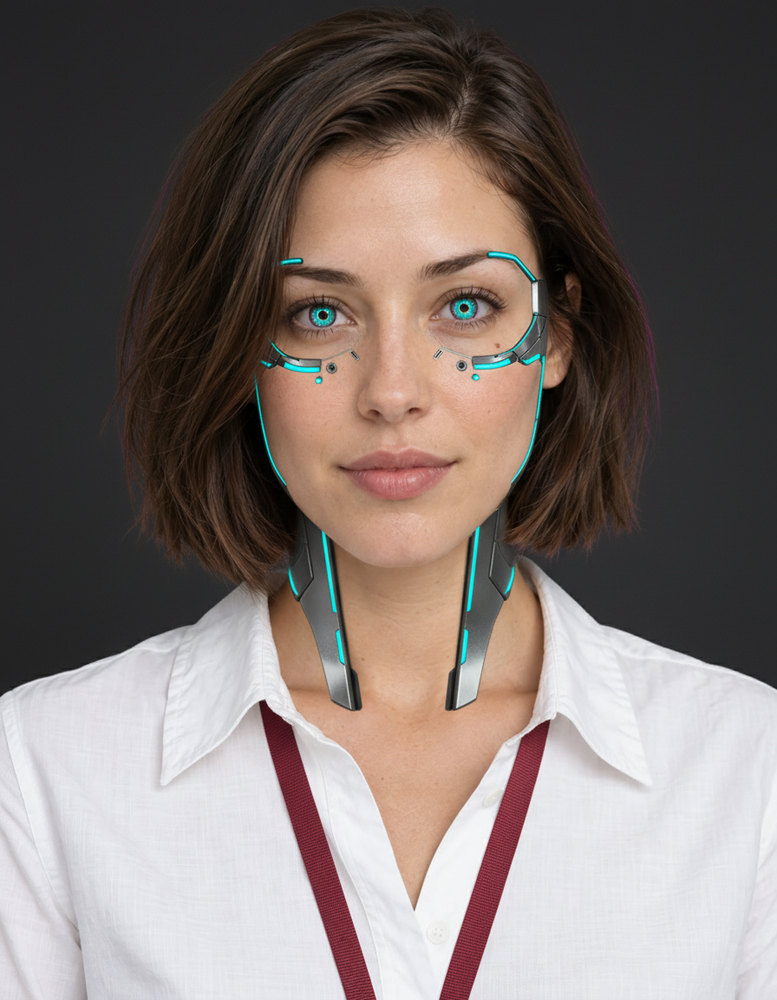
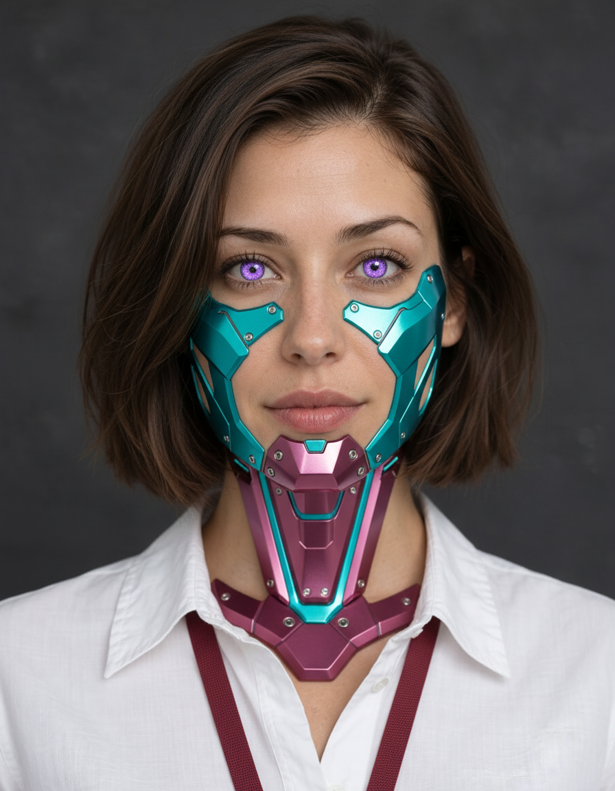
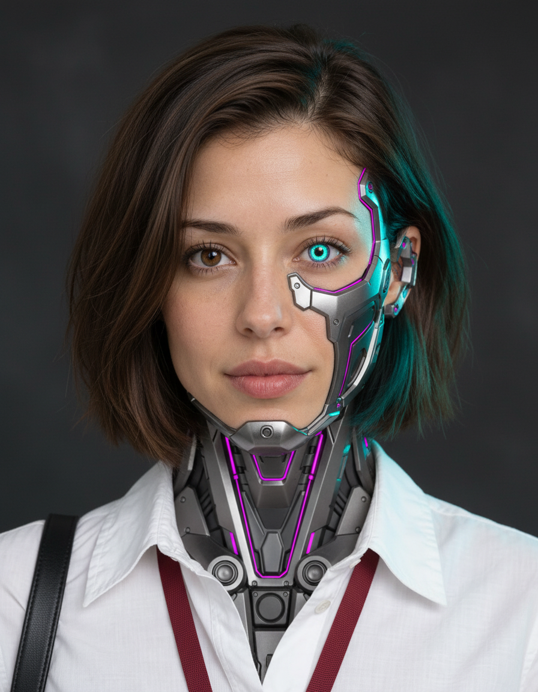
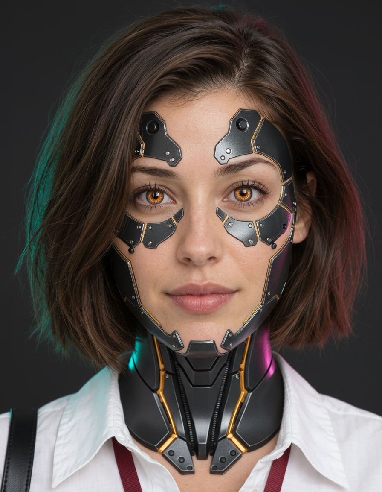

# Cyberpunk Riley — cheap concept batch

Four original Nano Banana portraits through ElevenLabs, one image per direction.
Each original is 896x1152; no crop or upscale. Total provider-reported cost:
1,320.3225 credits, approximately INR 19.17. **The user selected option 3's
face/cyberware direction.** The other concepts remain unselected.

| Option | Direction | Image |
|---|---|---|
| 1 | Chrome eye rails | [Open original](images/riley-cyberpunk-01-v01.png) |
| 2 | Turquoise cheek armor | [Open original](images/riley-cyberpunk-02-v01.png) |
| 3 | **Selected: asymmetric mechanical jaw** | [Open original](images/riley-cyberpunk-03-v01.png) |
| 4 | Black ceramic and gold | [Open original](images/riley-cyberpunk-04-v01.png) |

Option 3 is a selected design direction, not an upscaled production master.
Preserve its actual anatomical-left hardware/cyan eye (viewer right), even though
the original prompt requested the opposite side. Several designs obscure Riley's
identity mole; check facial identity and mechanical detail during refinement.
The user approved [wardrobe 05-v02](../02-wardrobe/CYBERPUNK-GALLERY.md): gold
dress, current boots and natural skin with slim chrome/cyan inlays. Pair it with
the selected face/neck design for the upgraded look.
The first subtle station image was rejected as insufficiently cyberpunk; it is
preserved separately as a composed-shot test.

[ElevenLabs concept flow](https://elevenlabs.io/app/flows/4osRqqkJAem3JCrPkFCF).
The Lite-model price-check node on that flow was never run.
