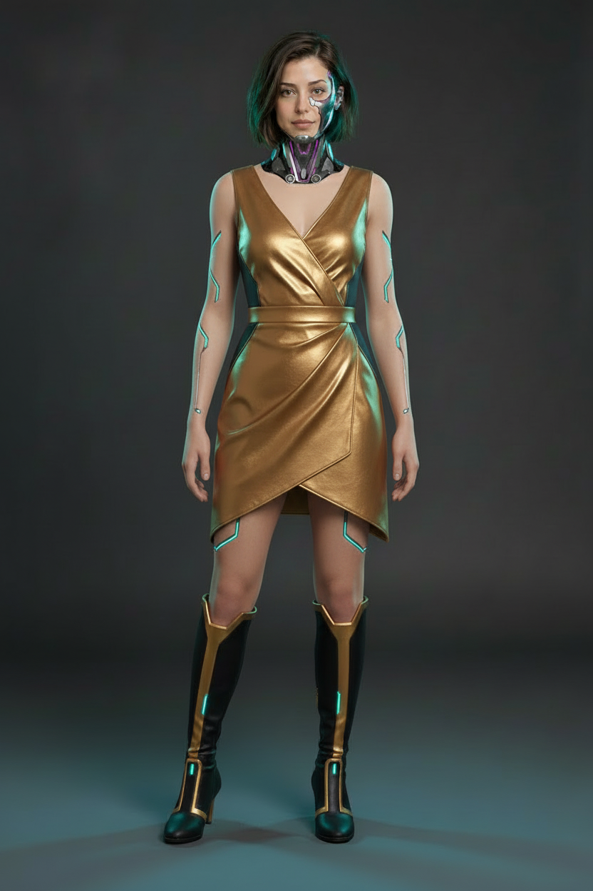
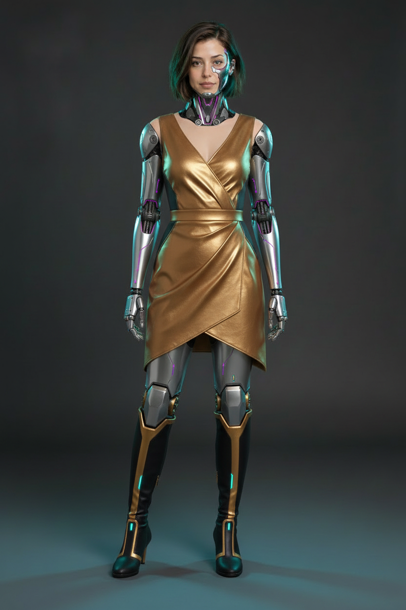
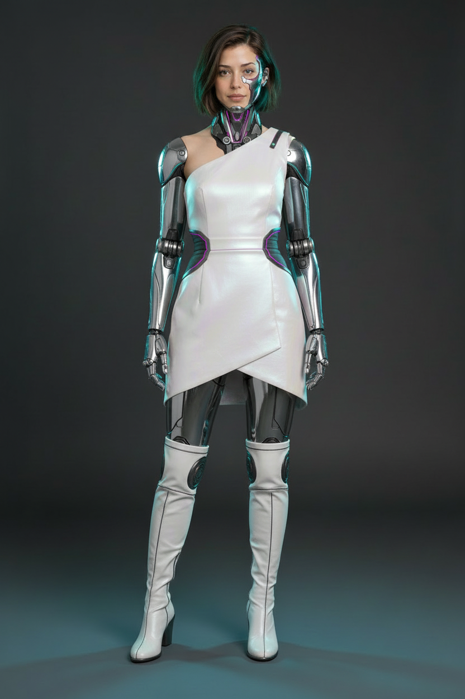
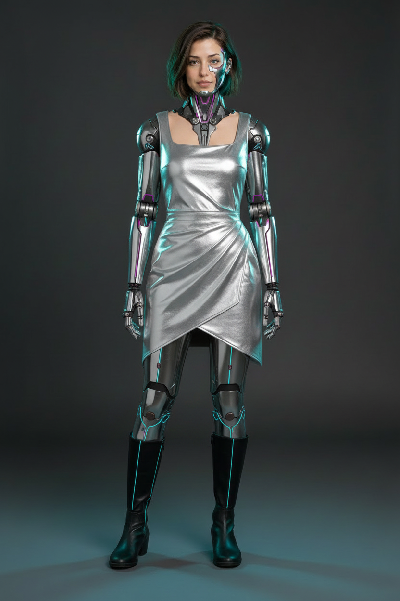
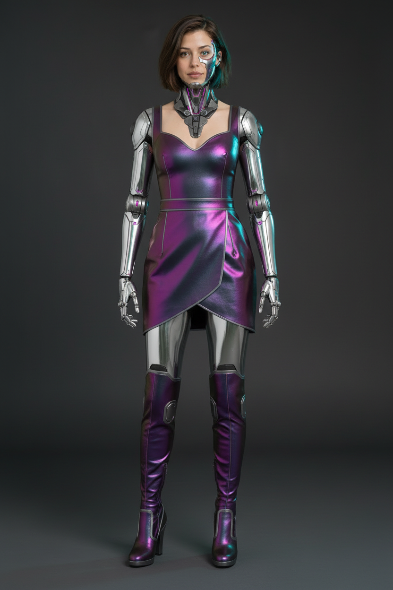
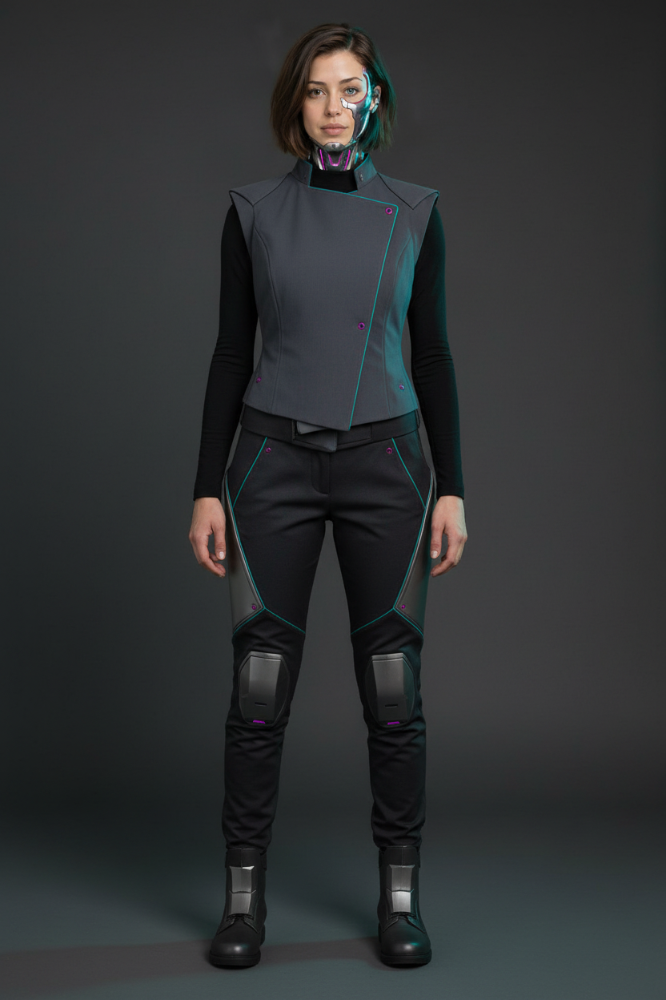
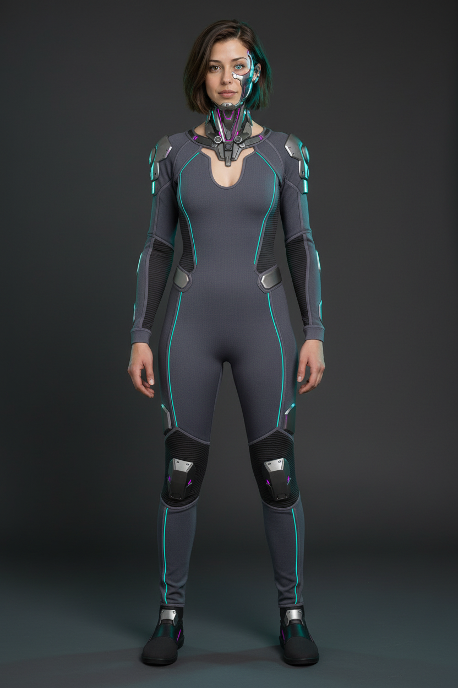
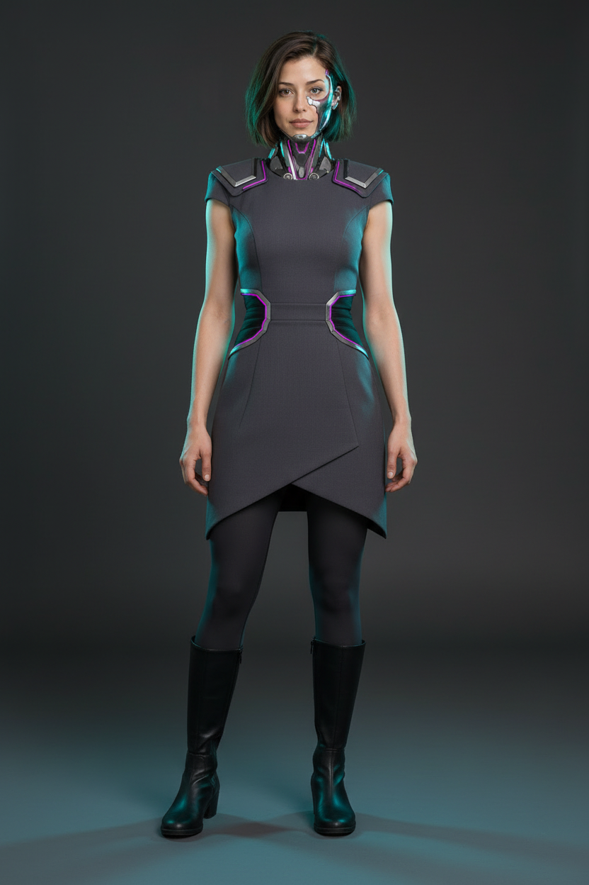
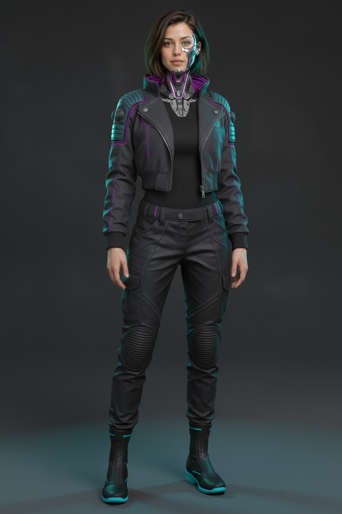

# Cyberpunk Riley — wardrobe options

## Selected — gold dress with natural skin and chrome inlays

The user approved **wardrobe 05-v02**: gold dress, current boots and human skin
with narrow chrome/cyan inlays. Fully metal arms and legs remain rejected. Pair
this selected wardrobe/body reference with Riley face/neck concept 3.

[Open wardrobe-cyberpunk-05-v02](images/wardrobe-cyberpunk-05-v02.png)

One focused Nano Banana edit through ElevenLabs; original 832x1248, no upscale.
Provider-reported cost: **267.208125 credits, approximately INR 3.88**.
Visually inspected: skin restored to shoulders, arms, hands, thighs and knees;
slim cyan-edged metallic inlays replace the large robot assemblies. The gold dress,
black/gold boots, framing and overall face/neck design remain visually consistent.
The stripes read mainly as luminous fine traces with metallic borders. The user
approved this skin/chrome balance and outfit as rendered. Use the selected Riley
portrait for detailed face/neck continuity; no upscale has started.

The earlier 85–90% skin wording was a prompt target, not a measured output ratio.
Preserve the current boot height and shape in this approved reference. The original
[05 v01](images/wardrobe-cyberpunk-05-v01.png) is preserved as the preferred outfit
source, not an approved complete-body design.

## Previous metallic dress batch

The user said the first wardrobe batch was too covered with clothes and lacked
chrome arms and legs. Wardrobe 3's dress looks fine but not great: it is the
revision base, not a selected final outfit. The new gold reference guides
metallic fashion materials while the selected Riley portrait controls identity.

Four new original Nano Banana images through ElevenLabs, 832x1248 each, no crop
or upscale. Total provider-reported cost: **1,194.5775 credits, approximately
INR 17.35**. The user prefers 05's outfit; its full-metal limb design is rejected.
Options 06–08 remain unselected.

| Option | Direction | Image |
|---|---|---|
| 5 | Liquid gold — gold wrap dress and chrome limbs | [Open original](images/wardrobe-cyberpunk-05-v01.png) |
| 6 | Pearl and chrome — white one-shoulder dress | [Open original](images/wardrobe-cyberpunk-06-v01.png) |
| 7 | Liquid silver — silver wrap dress and black boots | [Open original](images/wardrobe-cyberpunk-07-v01.png) |
| 8 | Iridescent violet — violet/petrol dress and matching boots | [Open original](images/wardrobe-cyberpunk-08-v01.png) |

The exposed mechanical arms/hands and chrome thighs are now clearly visible.
Boot tops generated around knee height rather than true thigh-high, and some
heels are taller than the requested low wedges. Refine boot height and movement
suitability on the chosen concept. The portrait remains authoritative for facial
hardware and the luminous cyan eye, which are simplified in these full-body
drafts. No final identity, outfit or motion approval is implied.

Earlier assistant observations favored 8's color contrast and 5's gold finish.
The user's subsequent preference for 05 supersedes that comparison.

[ElevenLabs revision flow](https://elevenlabs.io/app/flows/NAqLdem9GbIcQI3EWlTo).

## Preserved first batch

Four original Nano Banana images generated through ElevenLabs using the
user-selected [Riley concept 3](../01-riley/images/riley-cyberpunk-03-v01.png)
as the character reference. Each is 832x1248, native 2:3, with no crop or upscale.
Total provider-reported cost: **1,068.8325 credits, approximately INR 15.52**.
The user finds the batch too covered and insufficiently chrome. Option 3 is a
revision base; options 1, 2 and 4 are rejected as a wardrobe direction.

| Option | Direction | Image |
|---|---|---|
| 1 | Executive exosuit — asymmetric vest, technical trousers, armored ankle boots | [Open original](images/wardrobe-cyberpunk-01-v01.png) |
| 2 | Performance exosuit — flexible fitted suit with articulated armor | [Open original](images/wardrobe-cyberpunk-02-v01.png) |
| 3 | Armored asymmetric dress — overlapping skirt, leggings and tall boots | [Open original](images/wardrobe-cyberpunk-03-v01.png) |
| 4 | Street runner — cropped jacket, technical trousers and sprint boots | [Open original](images/wardrobe-cyberpunk-04-v01.png) |

All four show the full outfit and both shoes. They retain the broad bob,
asymmetric hardware placement and mechanical-neck design, but simplify facial
hardware and weaken the selected portrait's luminous cyan eye. These are costume
options, not replacement identity masters. Refine the chosen outfit with the
selected portrait before production. Option 1 partly covers the neck; option 2
introduces a low neckline; option 3's stride clearance needs motion review.

The earlier assistant recommendation of option 4 is superseded by the user's
dress and exposed-chrome direction. No upscale or video generation has started.

Exact prompts and generation records are beside the category's images and in
`prompts/`; [the manifest](cyberpunk-manifest.json) tracks state and dependencies.
[ElevenLabs wardrobe flow](https://elevenlabs.io/app/flows/PNrpy43WuEckWFISFlqe).
