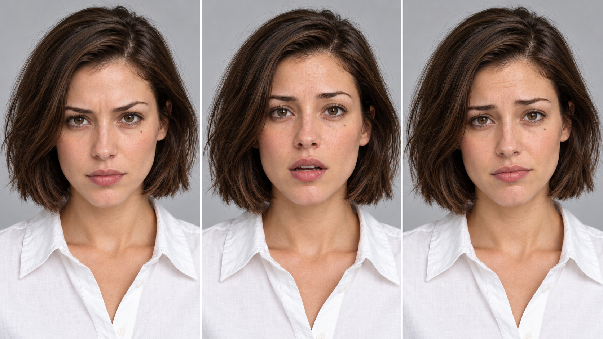
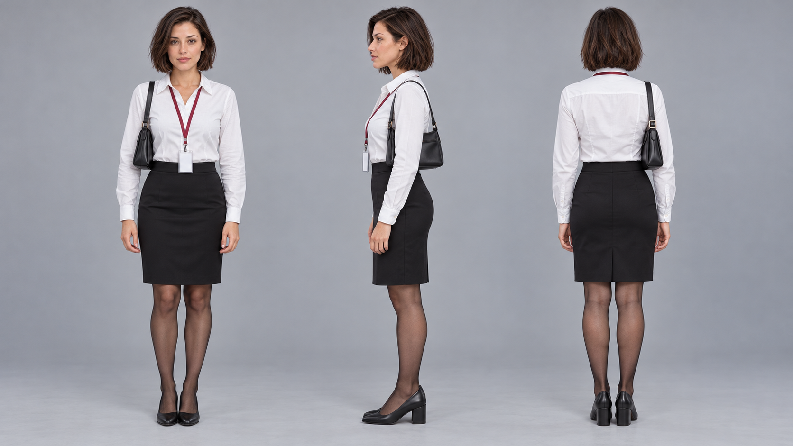
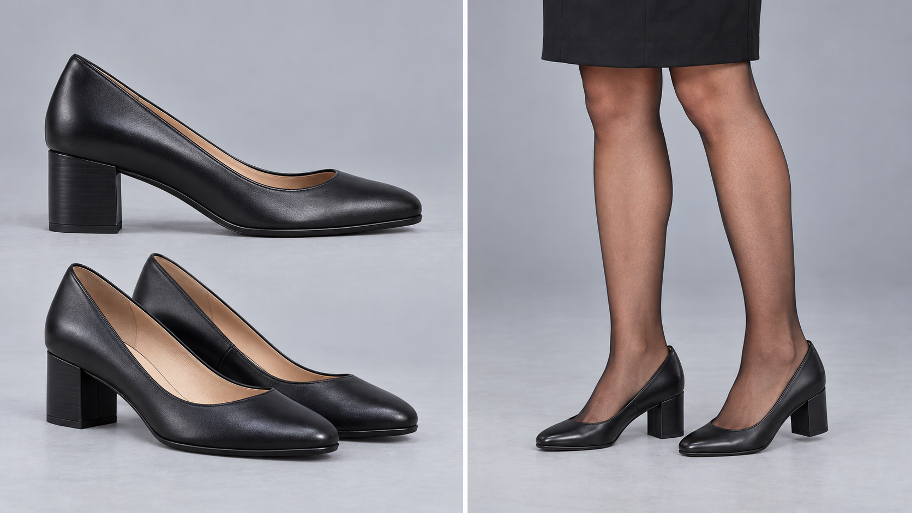
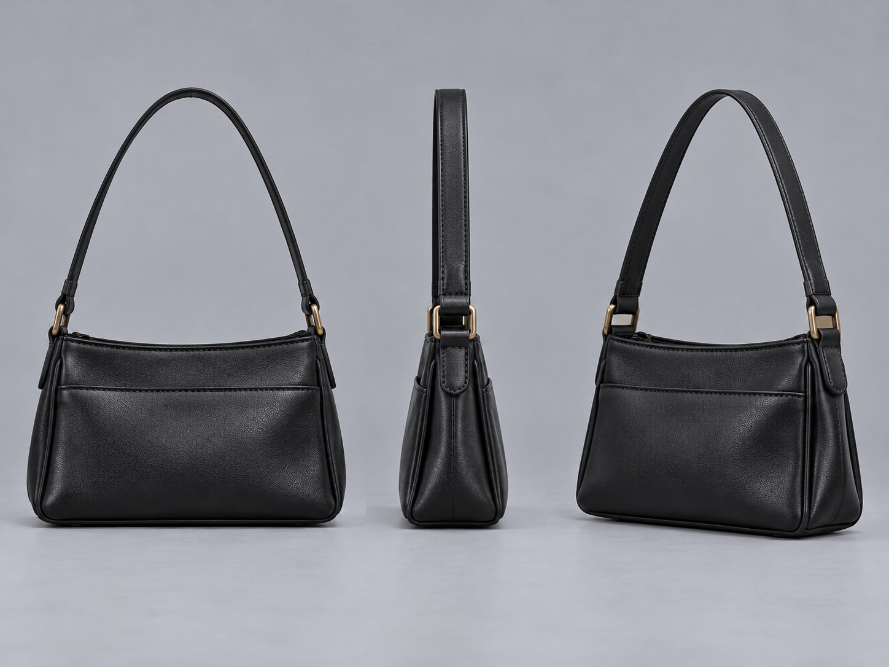
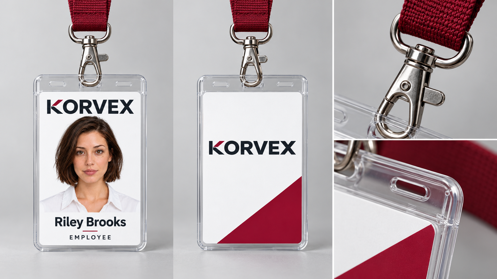
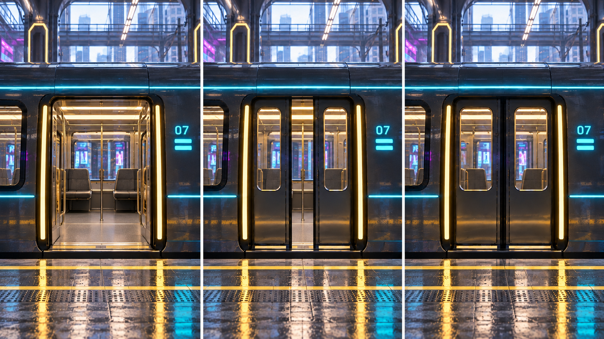

# Opening-hook test gallery

Generated using the built-in image generator. These are the selected **test** versions, pending your review. Earlier attempts and exact prompts remain in each category's image folder. See [README.md](README.md) for continuity notes.

## Four-shot hook

### shot-01 — Running legs starting frame

[Prompt](06-shots/prompts/shot-01.md) · [Exact generation record](06-shots/images/shot-01-v03.generation.json)

Selected v03 improves framing and sheer-black tights. Running skirt hem still rides above knee; reconcile with the knee-length wardrobe before final production.

### shot-02 — Bouncing badge starting frame

[Prompt](06-shots/prompts/shot-02.md) · [Exact generation record](06-shots/images/shot-02-v02.generation.json)

Visually checked and retained for this test batch; final user selection pending.

### shot-03 — Breathless face starting frame

[Prompt](06-shots/prompts/shot-03.md) · [Exact generation record](06-shots/images/shot-03-v02.generation.json)

Visually checked and retained for this test batch; final user selection pending.

### shot-04a — Door reveal starting frame

[Prompt](06-shots/prompts/shot-04a.md) · [Exact generation record](06-shots/images/shot-04a-v01.generation.json)

Visually checked and retained for this test batch; final user selection pending.

### shot-04b — Door reveal ending anchor

[Prompt](06-shots/prompts/shot-04b.md) · [Exact generation record](06-shots/images/shot-04b-v01.generation.json)

Overall framing retained, but door-panel detail varies from the start frame and Riley stops a few steps from the doorway. Check start/end motion compatibility before video generation.

## Reusable references

### riley-01 — Canonical identity portrait

[Prompt](01-riley/prompts/riley-01.md) · [Exact generation record](01-riley/images/riley-01-v01.generation.json)

### riley-02 — Three-quarter identity view

[Prompt](01-riley/prompts/riley-02.md) · [Exact generation record](01-riley/images/riley-02-v01.generation.json)

### riley-03 — Left profile identity view

[Prompt](01-riley/prompts/riley-03.md) · [Exact generation record](01-riley/images/riley-03-v01.generation.json)

### riley-04 — Low-angle face reference

[Prompt](01-riley/prompts/riley-04.md) · [Exact generation record](01-riley/images/riley-04-v01.generation.json)

### riley-05 — Running expression reference

[Prompt](01-riley/prompts/riley-05.md) · [Exact generation record](01-riley/images/riley-05-v01.generation.json)

### wardrobe-01 — Full outfit and bag turnaround

[Prompt](02-wardrobe/prompts/wardrobe-01.md) · [Exact generation record](02-wardrobe/images/wardrobe-01-v01.generation.json)

### wardrobe-02 — Heels and lower-body detail

[Prompt](02-wardrobe/prompts/wardrobe-02.md) · [Exact generation record](02-wardrobe/images/wardrobe-02-v01.generation.json)

### wardrobe-03 — Bag construction reference

[Prompt](02-wardrobe/prompts/wardrobe-03.md) · [Exact generation record](02-wardrobe/images/wardrobe-03-v01.generation.json)

### badge-01 — Employee headshot

[Prompt](03-badge/prompts/badge-01.md) · [Exact generation record](03-badge/images/badge-01-v01.generation.json)

### badge-02 — Badge front artwork

[Prompt](03-badge/prompts/badge-02.md) · [Exact generation record](03-badge/images/badge-02-v01.generation.json)

### badge-03 — Badge back artwork

[Prompt](03-badge/prompts/badge-03.md) · [Exact generation record](03-badge/images/badge-03-v02.generation.json)

### badge-04 — Physical badge and lanyard

[Prompt](03-badge/prompts/badge-04.md) · [Exact generation record](03-badge/images/badge-04-v01.generation.json)

### badge-05 — Badge worn on Riley

[Prompt](03-badge/prompts/badge-05.md) · [Exact generation record](03-badge/images/badge-05-v01.generation.json)

### station-01 — Station master environment

[Prompt](04-station/prompts/station-01.md) · [Exact generation record](04-station/images/station-01-v01.generation.json)

### train-01 — Train side and target door

[Prompt](05-train/prompts/train-01.md) · [Exact generation record](05-train/images/train-01-v02.generation.json)

### train-02 — Door states and visible interior

[Prompt](05-train/prompts/train-02.md) · [Exact generation record](05-train/images/train-02-v01.generation.json)

### station-02 — Ground-level running lane

[Prompt](04-station/prompts/station-02.md) · [Exact generation record](04-station/images/station-02-v01.generation.json)

### station-03 — Low-angle ceiling background

[Prompt](04-station/prompts/station-03.md) · [Exact generation record](04-station/images/station-03-v01.generation.json)

### station-04 — Target door environment plate

[Prompt](04-station/prompts/station-04.md) · [Exact generation record](04-station/images/station-04-v01.generation.json)
